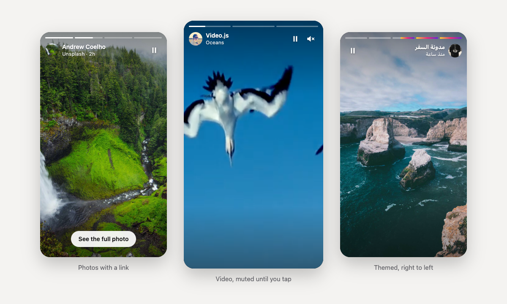

# videojs-story-view

[](https://www.npmjs.com/package/videojs-story-view)
[](https://github.com/hicay/videojs-story-view/actions/workflows/ci.yml)
[](./LICENSE)

Stories like the ones on Instagram, for the web. Give it a list of videos and
photos and it plays them one after another, with segmented progress bars, tap
to go back or forward, and press and hold to pause. Use it as a
`<story-view>` element on any page, or as a plugin for a Video.js 8 player.

<picture>
  <source media="(prefers-color-scheme: dark)" srcset="https://raw.githubusercontent.com/hicay/videojs-story-view/master/demo-dark.png" />
  
</picture>

Try it at [hicay.github.io/videojs-story-view](https://hicay.github.io/videojs-story-view/); it works best on a phone.

- Video and image stories, with a header (avatar, title, subtitle) and an optional link button
- Tap the left or right third to go back or forward, press and hold to pause, swipe sideways
- Keyboard: arrow keys, space, `M` to mute, Escape to close
- Starts muted with `playsinline`, so autoplay works on phones; unmute is one tap
- Pauses when the tab is hidden or the view is scrolled away, and loads the next story early
- Right-to-left layouts, screen reader labels, and `prefers-reduced-motion`
- Themed with CSS custom properties and `::part()`
- No dependencies, about 9 kB gzipped; Video.js 8 is optional
- Written in TypeScript

## Installation

```sh
npm install videojs-story-view
```

Or from a CDN, with no build step:

```html
<script src="https://cdn.jsdelivr.net/npm/videojs-story-view@1"></script>
```

The script registers `<story-view>` and, if a global `videojs` is already on
the page, the Video.js plugin. It also exposes everything below on
`window.VideojsStoryView`.

## Usage

### In HTML

Each `` or `<video>` inside `<story-view>` becomes a story.

```html
<script type="module">
  import 'videojs-story-view/define';
</script>

<story-view style="width: 360px" loop>
  <video src="ocean.mp4" preload="none" data-duration="8"
         data-title="Ada" data-subtitle="2h" data-avatar="ada.jpg"></video>
  
</story-view>
```

Use `preload="none"` on child videos and never `autoplay`: the children are
only read for their attributes, they are not shown.

The element is 9:16 by default. Set a `width`, or a `height` together with
`aspect-ratio: auto`.

### From JavaScript

```js
import 'videojs-story-view/define';

const stories = document.querySelector('story-view');
stories.items = [
  { src: 'ocean.mp4', duration: 8, title: 'Ada', avatar: 'ada.jpg' },
  { src: 'beach.jpg', alt: 'A sandy beach', link: { href: 'https://example.com' } },
];

stories.addEventListener('storychange', (event) => {
  console.log(`Story ${event.detail.index + 1}`);
});
stories.addEventListener('close', () => stories.remove());
```

### Video.js 8

The plugin plays the video stories through your player, so its HLS and DASH
support, techs and other plugins all apply. Image stories are drawn on top of
the player. The player's own controls are hidden while stories are showing.

```js
import videojs from 'video.js';
import 'video.js/dist/video-js.css';
import 'videojs-story-view/style.css';
import { registerStoryView } from 'videojs-story-view/videojs';

registerStoryView(videojs);

const player = videojs('my-player', { aspectRatio: '9:16', fluid: true });
const stories = player.storyView({
  items: [
    { src: 'https://example.com/live/index.m3u8', duration: 10, title: 'Live' },
    { src: 'photo.jpg' },
  ],
});

stories.on('complete', () => player.dispose());
```

`player.storyView()` returns the same API as the element (see
[Methods and properties](#methods-and-properties)). Calling it again replaces
the stories. It is removed when the player is disposed, or with
`stories.destroy()`, which also brings the controls back.

`style.css` is optional; it makes videos fill the player the way they do in
`<story-view>`. Importing `videojs-story-view/videojs` also adds
`player.storyView()` to Video.js 8's TypeScript types.

### Video.js 10 and other players

Video.js 10 is a different library: it is built from custom elements and has
no plugin system, so the plugin above does not apply to it. You don't need
one. Put `<story-view>` inside the player and point its `media` attribute at
the media element. The story view sets that element's `src` and plays and
pauses it; the Video.js 10 player sees each change like any other.

```html
<video-player>
  <media-container style="position: relative; aspect-ratio: 9 / 16">
    <video id="story-media" playsinline muted></video>
    <story-view media="story-media" style="position: absolute; inset: 0"></story-view>
  </media-container>
</video-player>

<script type="module">
  import '@videojs/html/video/player';
  import '@videojs/html/ui/container';
  import 'videojs-story-view/define';
</script>
```

`media` takes the id of any element with the `HTMLMediaElement` API: a plain
`<video>`, a Video.js 10 media element, or an element from another library.
You can also set the `media` property to the element itself. In this mode
image stories are drawn over the video, and the next video is not preloaded
(there is only one media element to play it in).

### React

React 19 passes properties and custom events to custom elements, so no
wrapper is needed.

```tsx
import 'videojs-story-view/define';
import type { StoryItem } from 'videojs-story-view';

export function Stories({ items, onClose }: { items: StoryItem[]; onClose: () => void }) {
  return (
    <story-view
      items={items}
      loop
      close-button=""
      onstorychange={(event) => console.log(event.detail.index)}
      onclose={onClose}
    />
  );
}
```

For TypeScript, declare the element once:

```ts
import type { StoryEventMap, StoryItem, StoryViewElement } from 'videojs-story-view';

type Handler<K extends keyof StoryEventMap> = (event: CustomEvent<StoryEventMap[K]>) => void;

declare module 'react' {
  namespace JSX {
    interface IntrinsicElements {
      'story-view': React.HTMLAttributes<StoryViewElement> &
        React.RefAttributes<StoryViewElement> & {
          items?: StoryItem[];
          loop?: boolean;
          muted?: boolean;
          'close-button'?: string;
          onstorychange?: Handler<'storychange'>;
          onclose?: Handler<'close'>;
        };
    }
  }
}
```

With React 18 or older, set `items` and add listeners through a `ref`.

The element module is safe to import during server rendering; it defines
nothing until it runs in a browser.

## Animated preview


## Options

On the element, options are attributes. Options that are on by default are
turned off with `="false"`, such as `autoplay="false"`. With the Video.js
plugin, pass them in the options object.

| Attribute | Option | Type | Default | Description |
| --- | --- | --- | --- | --- |
| | `items` | `StoryItem[]` | | The stories. On the element, a property or child elements. |
| `start-index` | `startIndex` | `number` | `0` | First story to show. |
| `autoplay` | `autoplay` | `boolean` | `true` | Start playing right away. |
| `loop` | `loop` | `boolean` | `false` | Start over after the last story. |
| `muted` | `muted` | `boolean` | `true` | Start muted. Browsers only autoplay muted video. |
| `image-duration` | `imageDuration` | `number` | `5` | Seconds an image is shown when it has no `duration`. |
| `hold-delay` | `holdDelay` | `number` | `200` | Milliseconds of pressing before it counts as press and hold. |
| `swipe-to-close` | `swipeToClose` | `boolean` | `false` | Swiping down fires `close`. Also stops the page scrolling while swiping on the story. |
| `close-button` | `closeButton` | `boolean` | `false` | Show a close button that fires `close`. |
| `keyboard` | `keyboard` | `boolean` | `true` | Keyboard shortcuts while the story view has focus. |
| `pause-when-hidden` | `pauseWhenHidden` | `boolean` | `true` | Pause while the browser tab is hidden. |
| `pause-when-offscreen` | `pauseWhenOffscreen` | `boolean` | `true` | Pause while less than half of the view is on screen. |
| `preload` | `preload` | `boolean` | `true` | Load the next story early. |
| `media` | `media` | id / element | | Play videos in this element. See [Video.js 10](#videojs-10-and-other-players). |
| `dir` | `dir` | `'ltr' \| 'rtl' \| 'auto'` | `'auto'` | Text direction. The element follows the page; set `dir="rtl"` on it or an ancestor. |
| | `labels` | `Partial<StoryLabels>` | English | Text for buttons and screen readers. A property on the element. |

Changing `muted` or `loop` on the element takes effect right away. Changing
any other attribute rebuilds the view and keeps the current story.

## Story items

| Field | Child element | Type | Description |
| --- | --- | --- | --- |
| `src` | `src` | `string` | Video or image URL. Required. |
| `type` | tag name | `'video' \| 'image'` | Guessed from the file extension when left out. |
| `mimeType` | `<source type>` | `string` | Such as `application/x-mpegURL` for HLS with the Video.js plugin. |
| `duration` | `data-duration` | `number` | Seconds. For images, how long to show them; for videos, where to cut them off. |
| `poster` | `poster` | `string` | Shown while a video loads, and if it fails. |
| `alt` | `alt` / `aria-label` | `string` | Text alternative for screen readers. |
| `title` | `data-title` | `string` | Header title, such as the author's name. |
| `subtitle` | `data-subtitle` | `string` | Header subtitle, such as "2h". |
| `avatar` | `data-avatar` | `string` | Header avatar URL. |
| `link` | `data-link`, `data-link-label`, `data-link-target` | `{ href, label?, target? }` | Button at the bottom. Opens in a new tab by default. Only `http(s):`, `mailto:` and `tel:` links are shown. |
| `id` | `id` / `data-id` | `string` | Your own identifier, passed back in events. |

A child `<script type="application/json">` with an array of items works too.

## Events

The element dispatches these as `CustomEvent`s with the data in `detail`. The
plugin's `stories.on(type, listener)` passes the data directly and returns a
function that removes the listener.

| Event | Data | When |
| --- | --- | --- |
| `storychange` | `{ index, previousIndex, item }` | A different story is showing. Also fires for the first one. |
| `storyend` | `{ index, item }` | A story played to its end. |
| `complete` | `{ loop }` | The last story ended. With `loop`, it starts over right after. |
| `pause` | `{ reason }` | Playback stopped. `reason` is `user`, `hold`, `hidden`, `offscreen` or `autoplay`. |
| `resume` | `{ reason }` | Playback continued. |
| `mutechange` | `{ muted }` | The viewer or your code changed the sound. |
| `progress` | `{ index, progress }` | Every frame while playing; `progress` goes from 0 to 1. |
| `buffering` | `{ buffering }` | The current video started or stopped waiting for data. |
| `error` | `{ index, item, error }` | A video failed. Its poster shows for `imageDuration`, then the next story plays. |
| `close` | `{ trigger }` | Escape, swipe down or the close button. Nothing closes by itself; remove or hide the view here. |

Pauses stack. A story the viewer paused stays paused when they switch tabs and
come back; it continues only when every reason is gone.

## Methods and properties

| Name | Description |
| --- | --- |
| `next()` | Next story. On the last one, ends (or starts over with `loop`). |
| `prev()` | Previous story. On the first one, starts it again. |
| `goTo(index)` | Show a story. Out-of-range values are clamped. |
| `play()` / `pause()` / `togglePlay()` | After the last story ended, `play()` starts from the first. |
| `toggleMute()` | Flip the sound. `muted` can also be set. |
| `items` | The stories. Setting it replaces them and shows the first. |
| `index`, `item` | The current story. |
| `paused`, `pauseReasons` | Whether it is paused, and why. |
| `ended` | True after the last story ended. |
| `progress` | Progress of the current story, 0 to 1. |
| `muted`, `loop` | Read and write. |
| `setItems(items, startIndex?)` | Plugin only; on the element, set `items`. |
| `on(type, listener)` / `off(type, listener)` / `destroy()` | Plugin only. The element cleans up when it is removed from the page. |

The package also exports `createStoryView(host, options)`, which renders into
any element, and `StoryEngine`, the timing and navigation logic without any
DOM, if you want to draw your own UI.

## Theming

Set these on `story-view`, a parent, or the Video.js player element.

| Custom property | Default | |
| --- | --- | --- |
| `--story-view-accent` | `#fff` | Filled part of the progress bars. Gradients work. |
| `--story-view-track` | `rgb(255 255 255 / 0.35)` | Empty part of the progress bars. |
| `--story-view-segment-height` | `3px` | |
| `--story-view-segment-gap` | `4px` | |
| `--story-view-radius` | `0` | Corner radius of the element. |
| `--story-view-inset` | `12px` | Padding around the bars and header. |
| `--story-view-avatar-size` | `32px` | |
| `--story-view-font` | system font, 14px | A `font` shorthand. |
| `--story-view-text-color` | `#fff` | |
| `--story-view-background` | `#000` | Behind media while it loads. |
| `--story-view-fit` | `cover` | `object-fit` for videos and images; `contain` shows the whole frame. |
| `--story-view-cta-background` | `rgb(255 255 255 / 0.92)` | Link button. |
| `--story-view-cta-color` | `#111` | |
| `--story-view-focus-ring` | `Highlight` | Outline when the element has keyboard focus. |
| `--story-view-transition` | `180ms` | Fades between stories and while holding. |

For anything else, style the parts:
`root`, `stage`, `video`, `image`, `progress`, `segment`, `segment-fill`,
`top`, `header`, `avatar`, `title`, `subtitle`, `actions`, `button`,
`pause-button`, `mute-button`, `close-button`, `zones`, `zone`, `zone-prev`,
`zone-toggle`, `zone-next`, `cta`, `spinner`.

```css
story-view {
  --story-view-accent: linear-gradient(90deg, #f9ce34, #ee2a7b, #6228d7);
  --story-view-radius: 20px;
}

story-view::part(title) {
  font-weight: 700;
}
```

While a story is held, the element has a `data-holding` attribute; while
paused, `data-paused`; while a video buffers, `data-buffering`.

## Accessibility

- The element is a labelled region (`aria-label="Stories"`, change it with
  `labels.region` or your own `aria-label`) and can take keyboard focus.
- The tap areas and icons are real buttons with labels, so screen readers and
  switch users can go back, forward, pause and unmute.
- While the viewer is interacting, story changes are announced ("Story 2 of 5:
  Ada"). Automatic advances are not, to keep screen readers quiet.
- Every story can be paused, which covers WCAG 2.2.2 (Pause, Stop, Hide).
  `autoplay="false"` starts paused.
- With `prefers-reduced-motion`, fades are turned off. Progress bars still
  move, since they show time rather than decorate.
- Give images an `alt` and videos an `alt` (or `aria-label` on child
  elements). Titles are set as text, never as HTML.
- In right-to-left pages, taps, swipes and arrow keys are mirrored.

All text can be translated through `labels`:

```js
stories.labels = { region: 'Hikayeler', next: 'Sonraki', previous: 'Önceki', position: '{index}/{total}' };
```

## Browser support

Browsers from 2022 on: Chrome and Edge 94+, Firefox 93+, Safari and iOS
Safari 15.4+. The package is ES2022 and is not transpiled further. Video
formats are up to the browser, or to Video.js when you use the plugin.

## Migrating from 0.0.1

1.0 is a rewrite. 0.0.1 drew one progress bar over a single Video.js 7 video
and had no options.

- Video.js 7 is not supported. Use Video.js 8, or `<story-view>` without
  Video.js.
- The plugin is no longer registered on import. Call
  `registerStoryView(videojs)` from `videojs-story-view/videojs`, or use the
  CDN script, which registers it when `window.videojs` exists.
- `player.storyView()` now needs `{ items }`.
- The `dist/videojs-story-view.min.js` and `.css` files are replaced by
  `dist/videojs-story-view.iife.js` and the optional `style.css`. Builds are
  no longer committed to the repository; get them from npm or a CDN.

## Media in the demo

The demo and the pictures above load media from their original hosts:
photos from [Unsplash](https://unsplash.com/license) through
[Lorem Picsum](https://picsum.photos/); the
[Sintel](https://durian.blender.org/) and
[Big Buck Bunny](https://peach.blender.org/) trailers, © Blender Foundation,
[CC BY 3.0](https://creativecommons.org/licenses/by/3.0/); and the Oceans
clip, the sample video Video.js uses in its own examples.

## Contributing

See [CONTRIBUTING.md](./CONTRIBUTING.md).

## License

[MIT](./LICENSE)
